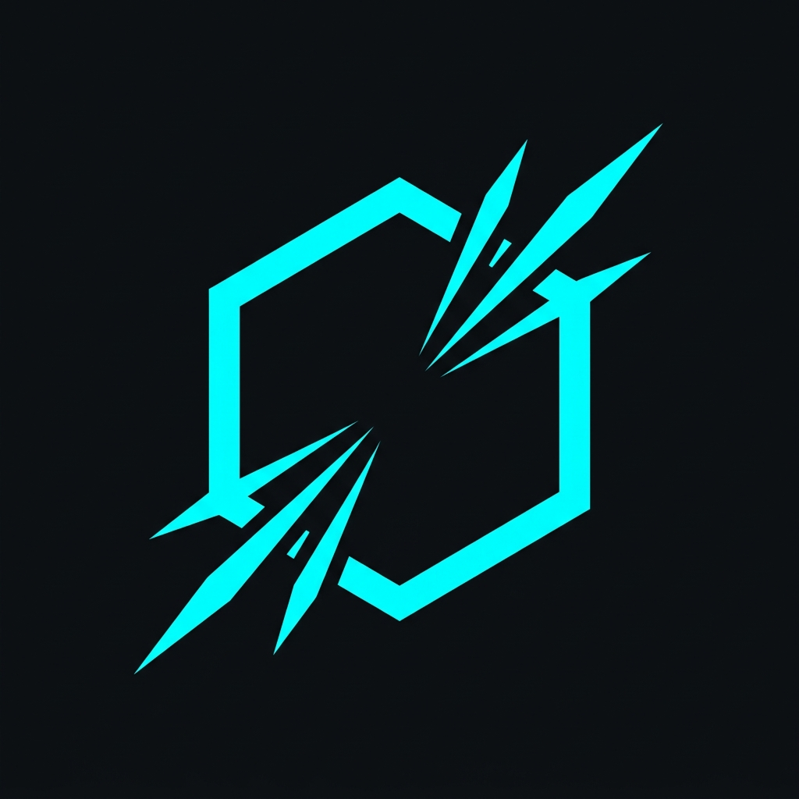

<div align="center">



# AI AGENTS SKILLS

### *Supercharge Your Agentic AI Coding Assistants with 184+ Production-Grade Skills, Personas & Workflows*

[](LICENSE)
[](https://github.com/satiricalguru/Agents-skills/pulls)
[](#-installation)
[](#-installation)
[](#-installation)
[](#%EF%B8%8F-available-skills)

<br/>

> 🚀 **[TRY THE INTERACTIVE DASHBOARD LIVE!](https://satiricalguru.github.io/Agents-skills/)**
> 
> *Browse, mix, and compile custom system instructions for Antigravity IDE, Claude Code, Cursor, Windsurf, and ChatGPT in seconds!*

</div>

---

<div align="center">

### 💡 Why AI Agents Skills?

| 🛠️ **184+ Specialized Skills** | 👥 **4+ Expert Personas** | 📂 **Curated 2026 Prompts** | ⚡ **1-Command Install** |
| :--- | :--- | :--- | :--- |
| Modular workflows for TDD, Security, Web Scraping, DevTools & Science | Senior Staff Reviewer, QA Specialist, & Security Auditor personas | Raw system prompts for Antigravity, Claude Opus 5, GPT-5.6 Sol & Gemini 3.6 | Single `curl` script or `npx` command to equip your local agent |

</div>

---

## 📑 Table of Contents

- [Available Skills](#️-available-skills)
  - [Meta & General Execution](#meta--general-execution)
  - [Define - Clarify what to build](#define---clarify-what-to-build)
  - [Plan - Break it down](#plan---break-it-down)
  - [Build - Write the code](#build---write-the-code)
  - [Verify - Prove it works](#verify---prove-it-works)
  - [Review - Quality gates before merge](#review---quality-gates-before-merge)
  - [Ship - Deploy with confidence](#ship---deploy-with-confidence)
  - [Specialized Tools & Systems](#specialized-tools--systems)
  - [Modern Web Design & Layout Systems](#modern-web-design--layout-systems)
  - [Creative Motion, Shaders & WebGL 3D](#creative-motion-shaders--webgl-3d)
  - [Game Development & Three.js Systems](#game-development--threejs-systems)
  - [Audit, Quality & Anti-Slop Safeguards](#audit-quality--anti-slop-safeguards)
  - [Creative Sourcing, Media & Generation](#creative-sourcing-media--generation)
  - [Antigravity IDE & System Orchestration](#antigravity-ide--system-orchestration)
- [Specialist Personas](#-specialist-personas)
- [Reference Checklists](#-reference-checklists)
- [Curated AI Model Prompts](#-curated-ai-model-prompts)
- [Installation](#-installation)
- [Skill-Specific Setup](#️-skill-specific-setup)
- [Adding New Skills](#-adding-new-skills)
- [Global System Skills](#-global-system-skills)

---

## 🛠️ Available Skills

### Meta & General Execution

| Skill | Description | Use When |
| :--- | :--- | :--- |
| **[`using-agent-skills`](skills/using-agent-skills.md)** | Maps incoming work to the right skill workflow and defines shared operating rules. | Starting a session or deciding which skill applies |
| **[`no-excuses-executor`](skills/no-excuses-executor.md)** | Direct task execution with zero hedging. Forces action-first completion, suppresses over-caution. | Running direct actions/commands without hesitation |

### Define - Clarify what to build

| Skill | Description | Use When |
| :--- | :--- | :--- |
| **[`interview-me`](skills/interview-me.md)** | One-question-at-a-time interview that extracts what the user actually wants instead of what they think they should want, until ~95% confidence. | The ask is underspecified, or the user invokes "interview me" / "grill me" |
| **[`idea-refine`](skills/idea-refine.md)** | Structured divergent/convergent thinking to turn vague ideas into concrete proposals. | You have a rough concept that needs exploration |
| **[`spec-driven-development`](skills/spec-driven-development.md)** | Write a PRD covering objectives, commands, structure, code style, testing, and boundaries before any code. | Starting a new project, feature, or significant change |

### Plan - Break it down

| Skill | Description | Use When |
| :--- | :--- | :--- |
| **[`planning-and-task-breakdown`](skills/planning-and-task-breakdown.md)** | Decompose specs into small, verifiable tasks with acceptance criteria and dependency ordering. | You have a spec and need implementable units |

### Build - Write the code

| Skill | Description | Use When |
| :--- | :--- | :--- |
| **[`incremental-implementation`](skills/incremental-implementation.md)** | Thin vertical slices - implement, test, verify, commit. Feature flags, safe defaults, rollback-friendly changes. | Any change touching more than one file |
| **[`test-driven-development`](skills/test-driven-development.md)** | Red-Green-Refactor, test pyramid (80/15/5), test sizes, DAMP over DRY, Beyonce Rule, browser testing. | Implementing logic, fixing bugs, or changing behavior |
| **[`context-engineering`](skills/context-engineering.md)** | Feed agents the right information at the right time - rules files, context packing, MCP integrations. | Starting a session, switching tasks, or when output quality drops |
| **[`source-driven-development`](skills/source-driven-development.md)** | Ground every framework decision in official documentation - verify, cite sources, flag what's unverified. | You want authoritative, source-cited code for any framework or library |
| **[`doubt-driven-development`](skills/doubt-driven-development.md)** | Adversarial fresh-context review of every non-trivial decision in-flight - CLAIM → EXTRACT → DOUBT → RECONCILE → STOP, with optional user-authorized cross-model escalation. | Stakes are high (production, security, irreversible), working in unfamiliar code, or verifying early is cheaper |
| **[`frontend-ui-engineering`](skills/frontend-ui-engineering.md)** | Component architecture, design systems, state management, responsive design, WCAG 2.1 AA accessibility. | Building or modifying user-facing interfaces |
| **[`api-and-interface-design`](skills/api-and-interface-design.md)** | Contract-first design, Hyrum's Law, One-Version Rule, error semantics, boundary validation. | Designing APIs, module boundaries, or public interfaces |

### Verify - Prove it works

| Skill | Description | Use When |
| :--- | :--- | :--- |
| **[`browser-testing-with-devtools`](skills/browser-testing-with-devtools.md)** | Chrome DevTools MCP for live runtime data - DOM inspection, console logs, network traces, performance profiling. | Building or debugging anything that runs in a browser |
| **[`debugging-and-error-recovery`](skills/debugging-and-error-recovery.md)** | Five-step triage: reproduce, localize, reduce, fix, guard. Stop-the-line rule, safe fallbacks. | Tests fail, builds break, or behavior is unexpected |

### Review - Quality gates before merge

| Skill | Description | Use When |
| :--- | :--- | :--- |
| **[`code-review-and-quality`](skills/code-review-and-quality.md)** | Five-axis review, change sizing (~100 lines), severity labels (Nit/Optional/FYI), review speed norms, splitting strategies. | Before merging any change |
| **[`code-simplification`](skills/code-simplification.md)** | Chesterton's Fence, Rule of 500, reduce complexity while preserving exact behavior. | Code works but is harder to read or maintain than it should be |
| **[`security-and-hardening`](skills/security-and-hardening.md)** | OWASP Top 10 prevention, auth patterns, secrets management, dependency auditing, three-tier boundary system. | Handling user input, auth, data storage, or external integrations |
| **[`performance-optimization`](skills/performance-optimization.md)** | Measure-first approach - Core Web Vitals targets, profiling workflows, bundle analysis, anti-pattern detection. | Performance requirements exist or you suspect regressions |

### Ship - Deploy with confidence

| Skill | Description | Use When |
| :--- | :--- | :--- |
| **[`git-workflow-and-versioning`](skills/git-workflow-and-versioning.md)** | Trunk-based development, atomic commits, change sizing (~100 lines), the commit-as-save-point pattern. | Making any code change (always) |
| **[`ci-cd-and-automation`](skills/ci-cd-and-automation.md)** | Shift Left, Faster is Safer, feature flags, quality gate pipelines, failure feedback loops. | Setting up or modifying build and deploy pipelines |
| **[`deprecation-and-migration`](skills/deprecation-and-migration.md)** | Code-as-liability mindset, compulsory vs advisory deprecation, migration patterns, zombie code removal. | Removing old systems, migrating users, or sunsetting features |
| **[`documentation-and-adrs`](skills/documentation-and-adrs.md)** | Architecture Decision Records, API docs, inline documentation standards - document the *why*. | Making architectural decisions, changing APIs, or shipping features |
| **[`observability-and-instrumentation`](skills/observability-and-instrumentation.md)** | Structured logging, RED metrics, OpenTelemetry tracing, symptom-based alerting - instrument as you build. | Adding telemetry, or shipping anything that runs in production |
| **[`shipping-and-launch`](skills/shipping-and-launch.md)** | Pre-launch checklists, feature flag lifecycle, staged rollouts, rollback procedures, monitoring setup. | Preparing to deploy to production |

### Specialized Tools & Systems

| Skill | Description | Key Features & Integrations |
| :--- | :--- | :--- |
| **[`mongodb`](skills/mongodb.md)** | Model data, connect, write updates, index schemas, run aggregations, and perform Atlas/Vector search in MongoDB. | Mongoose models, update operators, ESR indexes, multi-document transactions, Atlas search |
| **[`reverse-engineering-skill`](skills/reverse-engineering-skill.md)** | Binary analysis, firmware extraction, vulnerability research, and CTF solvers. | Ghidra MCP, radare2-mcp, angr symbolic execution, class-dump, jadx, checksec |
| **[`supabase`](skills/supabase.md)** | Integrate, query, manage migrations, TypeScript type generation, and configure RLS on Supabase. | Postgres migrations, RLS security, Next.js SSR cookie auth, Edge Functions, pgvector |
| **[`web-scraper`](skills/web-scraper.md)** | Adaptive web scraping with traffic interception, framework detection, anti-blocking, and Apify Actor creation. | Traffic interception, cURL recon, Playwright/Puppeteer signatures, Apify SDK |

### Modern Web Design & Layout Systems

| Skill | Description |
| :--- | :--- |
| **[`agency-grid-layout-minimal`](skills/agency-grid-layout-minimal.md)** | Create a minimal agency design system with a disciplined editorial grid, oversized typography, quiet uppercase utility labels, restrained image blocks, and subtle structural det... |
| **[`beautiful-shadows`](skills/beautiful-shadows.md)** | Apply exact Tailwind arbitrary shadow utilities for polished, layered neutral elevation. Use when compact cards, controls, panels, popovers, hero media, feature callouts, or mod... |
| **[`blue-cloudy-clean-modern`](skills/blue-cloudy-clean-modern.md)** | Create a clean modern design system with a luminous blue sky atmosphere, soft drifting cloud light, minimal white framing, and serene premium typography. |
| **[`blue-laser-clean-glass-layout`](skills/blue-laser-clean-glass-layout.md)** | Create a clean dark glass layout system with a thin blue laser atmosphere, frosted premium shells, and polished dashboard structure. |
| **[`book-serif-index`](skills/book-serif-index.md)** | Create an archival book-reader design system with serif-led pages, mono index navigation, aged paper surfaces, margin notes, and a premium catalog frame. |
| **[`bright-green-tech-system-webgl`](skills/bright-green-tech-system-webgl.md)** | Create a bright-green technical design system with structured split layouts, hard-framed dark surfaces, mono utility labels, and a prominent WebGL visualization zone. |
| **[`clean-minimal-beige-light-mode`](skills/clean-minimal-beige-light-mode.md)** | Create a clean minimal beige light-mode design system with warm neutral shells, quiet process grids, restrained accent color, and elegant low-contrast structure. |
| **[`container-lines`](skills/container-lines.md)** | Add vertical container-size guide lines with mini corner squares for precise, structured web layouts. Use when asked for container lines, measured layout guides, vertical bounda... |
| **[`corner-diagonals`](skills/corner-diagonals.md)** | Apply diagonal-cut corners and chamfered edges to buttons, cards, panels, and container shells. Use when a design needs precise geometric framing, sci-fi UI surfaces, clipped-co... |
| **[`corner-lasers`](skills/corner-lasers.md)** | Create a corner-anchored laser composition with thin beams, a bright emitter node, bloom, and atmospheric glow or fog. |
| **[`css-alpha-masking`](skills/css-alpha-masking.md)** | Apply CSS alpha masking with linear-gradient for horizontal or vertical edge fades (mask-image and -webkit-mask-image). Use when asked for alpha masks, fade edges, or CSS mask g... |
| **[`css-border-gradient`](skills/css-border-gradient.md)** | Apply subtle gradient-border treatments for premium web surfaces. Use when cards, pricing panels, nav bars, modals, buttons, or hero surfaces need a refined edge highlight witho... |
| **[`dark-blue-contrasting-clean`](skills/dark-blue-contrasting-clean.md)** | Create a dark-blue clean design system with strong contrast, cobalt gradient feature blocks, crisp framed structure, and restrained premium glow. |
| **[`dark-glass-clean-layout`](skills/dark-glass-clean-layout.md)** | Create a dark glass layout system with frosted premium shells, clean multi-column workspace structure, floating data cards, and restrained atmospheric depth. |
| **[`dither-background`](skills/dither-background.md)** | Create a dark monochrome procedural background with enlarged square pixels and visible Bayer-style ordered dithering. Use when a page needs an atmospheric near-black dither fiel... |
| **[`dither-laser-dark-mode`](skills/dither-laser-dark-mode.md)** | Create a dark premium design system that combines near-black surfaces, subtle ordered-dither texture, and a thin accent-colored laser atmosphere. |
| **[`documentary-brutalist-agency`](skills/documentary-brutalist-agency.md)** | Create or redesign creative agency, production studio, architecture, culture, and portfolio websites with billboard typography, hard black-and-white chapters, exposed grids, doc... |
| **[`editorial-portfolio-chapters`](skills/editorial-portfolio-chapters.md)** | Create or redesign creative-studio, agency, photographer, artist, and portfolio websites where project work leads the story. Use for dark editorial shells, full-bleed campaign m... |
| **[`editorial-service-booking`](skills/editorial-service-booking.md)** | Create or redesign appointment-based service websites for salons, barbers, spas, wellness studios, clinics, and hospitality brands. Use for warm editorial layouts, serif-led ide... |
| **[`editorial-tech`](skills/editorial-tech.md)** | Blend editorial magazine composition with precision product-tech detailing using asymmetrical grids, cinematic media bands, mono utility labels, and restrained accent color. |
| **[`framed-grid-layout`](skills/framed-grid-layout.md)** | Create minimal framed grid layouts with thin visible boundary lines, L-shaped corner brackets, subtle diagonal line texture, and strict section alignment. Use when asked for cle... |
| **[`framed-tech-dark-border-gradient`](skills/framed-tech-dark-border-gradient.md)** | Create a framed dark technical design system with border-gradient shells, asymmetrical grid panels, mono utility labeling, and restrained monochrome atmosphere. |
| **[`funky-purple-container-tech`](skills/funky-purple-container-tech.md)** | Create a dark container-led technical design system with fuchsia-purple accents, layered rounded shells, crisp frame lines, and playful futuristic focal objects. |
| **[`glass-dark-mode-clock`](skills/glass-dark-mode-clock.md)** | Create a dark glass design system with frosted shells, soft beam grids, circular clock-like calibration dials, and precise sci-fi instrument framing. |
| **[`glass-dark-ui`](skills/glass-dark-ui.md)** | Build dark-mode glassmorphism interfaces with readable contrast, frosted surfaces, and gradient borders using a pseudo-element mask. Use when asked for glass cards, frosted dark... |
| **[`gooey-blob-system`](skills/gooey-blob-system.md)** | Create a gooey blob system using SVG filters where multiple shapes merge into a single fluid form. Use overlapping circles combined with a Gaussian blur and color matrix filter ... |
| **[`ui-ux-pro-max`](skills/ui-ux-pro-max.md)** | AI-powered design intelligence with 84 UI styles, 192 color palettes, 74 font pairings, 98 UX guidelines, and 25 chart types across 22 tech stacks. |

### Creative Motion, Shaders & WebGL 3D

| Skill | Description |
| :--- | :--- |
| **[`add-mouse-driven-orbit`](skills/add-mouse-driven-orbit.md)** | Add restrained mouse-driven orbit and parallax depth to a Three.js hero by damping one pointer target and splitting it across camera translation, look-at, and small object rotat... |
| **[`add-shader-cursor-trail`](skills/add-shader-cursor-trail.md)** | Add the Shaders WebGPU mouse effect used for the Tidal Commons hero: a white twinkling halftone cursor trail driven by ChromaFlow, masked through a DotGrid, finished with chroma... |
| **[`ambient-section-particles`](skills/ambient-section-particles.md)** | Add a restrained particle atmosphere inside one section with configurable shapes, density, gravity, wind, sway, rotation, recycling or settling, pointer disturbance, visibility ... |
| **[`animation-on-scroll`](skills/animation-on-scroll.md)** | Create an on-scroll animation trigger using IntersectionObserver with Tailwind-friendly animation classes and keyframes. Use when asked for scroll-reveal, animate-on-scroll, or ... |
| **[`animation-systems`](skills/animation-systems.md)** | Use when designing or implementing product-grade web motion like Stripe, Linear, Apple, and Vercel. Covers motion principles, easing/duration defaults, choreography patterns, sc... |
| **[`atmosphere-background`](skills/atmosphere-background.md)** | Create a dark atmospheric background with drifting vertical light folds, screen-blended glow, and a concentrated luminous corner or lower-edge bloom. |
| **[`background-grid-webgl`](skills/background-grid-webgl.md)** | Create a perspective WebGL background grid with fading lines, subtle particle haze, slow forward drift, and gentle camera parallax. |
| **[`beam-glow-states`](skills/beam-glow-states.md)** | Create React loading, processing, selected, current, focus, and pressed states with the border-beam package's animated edge glow. Use when a card, button, input, tab, option, ta... |
| **[`build-awwwards-quality-sites`](skills/build-awwwards-quality-sites.md)** | Art-direct and implement distinctive, motion-rich marketing, editorial, portfolio, and landing websites with original reference-inspired imagery, standout heroes, GSAP choreogra... |
| **[`build-interactive-particle-trail`](skills/build-interactive-particle-trail.md)** | Build a cursor or touch particle interaction that emits by distance along the traveled segment into a recycled GPU point pool, with optional keyboard-triggered bursts. Use for i... |
| **[`build-threejs-scroll-worlds`](skills/build-threejs-scroll-worlds.md)** | Build rich, scroll-controlled real-time Three.js experiences as one persistent 3D world whose camera, lighting, atmosphere, materials, objects, DOM story, and interactions evolv... |
| **[`build-wireframe-scan-reveal`](skills/build-wireframe-scan-reveal.md)** | Reveal Three.js geometry with an expanding world-space scan whose wire cage leads the solid surface, then burns away. Use for wireframe scanning, radial mesh reveals, survey pul... |
| **[`cinematic-gsap-lenis-motion-system`](skills/cinematic-gsap-lenis-motion-system.md)** | Create premium cinematic web motion systems with GSAP, ScrollTrigger, and Lenis. Use for luxury editorial websites, creative studio portfolios, Awwwards-style interactions, smoo... |
| **[`cinematic-scroll-storytelling`](skills/cinematic-scroll-storytelling.md)** | Create cinematic scroll-driven landing pages with Lenis smooth scrolling, GSAP ScrollTrigger, scroll-linked progression, staggered text reveals, sticky card stacks, parallax bac... |
| **[`cobejs`](skills/cobejs.md)** | Use when adding a lightweight interactive globe with cobe (canvas setup, markers, interaction, performance, integration with React/Next.js). |
| **[`falling-leaves`](skills/falling-leaves.md)** | Build falling leaves that read as leaves, with each one tumbling on its own axis so it presents a face, thins to an edge, and opens out again, and with its sideways slip driven ... |
| **[`globe-gl`](skills/globe-gl.md)** | Use when implementing globe.gl (Globe.GL) for 3D globe data visualization with WebGL/ThreeJS, including setup, data layers (points, arcs, polygons, labels), and integration patt... |
| **[`globe-particles`](skills/globe-particles.md)** | Create a globe-like 3D particle visualization with a dense luminous spherical core and thinner orbital ring or flattened disc. Use when a design needs a premium planetary, orbit... |
| **[`gsap-scrolltrigger-storytelling`](skills/gsap-scrolltrigger-storytelling.md)** | Build cinematic sticky product storytelling with GSAP ScrollTrigger, progressive UI reveals, scroll-synced animation, smooth interpolation, and immersive section transitions. |
| **[`optimize-web-animations`](skills/optimize-web-animations.md)** | Profile, audit, and optimize frontend page performance with emphasis on animation work, memory-leak risks, long-session slowdowns, CSS animations, canvas/WebGL requestAnimationF... |

### Game Development & Three.js Systems

| Skill | Description |
| :--- | :--- |
| **[`author-game-levels`](skills/author-game-levels.md)** | Author or revise readable, flat-world Three.js game levels. Use for movement and camera routes, collision and navigation, encounter zones, landmarks, objectives, pickups, motiva... |
| **[`build-game-audio-feedback`](skills/build-game-audio-feedback.md)** | Design or implement responsive audio feedback for a Three.js or web game. Use for action sounds, combat layers, music states, spatial audio, mix priorities, mute controls, acces... |
| **[`build-game-camera-controls`](skills/build-game-camera-controls.md)** | Implement or tune Three.js game cameras. Use for isometric framing, follow behavior, orbit/zoom limits, occlusion, lock-on, camera shake, touch camera controls, and camera regre... |
| **[`build-game-changelog`](skills/build-game-changelog.md)** | Design, implement, backfill, audit, and release in-game changelogs with contiguous versioning, deployment provenance, menu-state navigation, accessible toggle, close, and Escape... |
| **[`build-game-inventory`](skills/build-game-inventory.md)** | Build or repair game inventory, loot, equipment, tooltips, drag-and-drop, persistence, and progression systems. Use for item schemas, pickup flows, stack rules, equipment slots,... |
| **[`build-game-map-editor`](skills/build-game-map-editor.md)** | Build, extend, or audit production-linked browser map editors for Three.js and isometric games. Use when Codex needs to create a private director view, derive a versioned editor... |
| **[`build-game-monster-system`](skills/build-game-monster-system.md)** | Build, integrate, audit, or refactor rigged monsters for Three.js and web action games. Use for monster asset contracts, procedural or imported creature rigs, semantic joints an... |
| **[`build-hybrid-game-assets`](skills/build-hybrid-game-assets.md)** | Plan, create, integrate, or audit a hybrid asset pipeline for a Three.js or web game. Use when choosing among imported meshes, procedural 3D geometry, AI-generated reference art... |
| **[`build-isometric-arpg`](skills/build-isometric-arpg.md)** | Build or extend a playable isometric action RPG in Three.js, React, or similar web technology. Use for game-loop architecture, camera and movement, zones, combat integration, co... |
| **[`build-mobile-threejs-games`](skills/build-mobile-threejs-games.md)** | Build, tune, or test a Three.js game for mobile web. Use for touch movement, action controls, target selection, touch inventory, safe areas, portrait/landscape layouts, responsi... |
| **[`build-rigged-game-assets`](skills/build-rigged-game-assets.md)** | Create, integrate, or audit production-ready rigged 3D characters and monsters with a main model, skeleton, animation library, sockets, collision contracts, separate character e... |
| **[`build-threejs-enemy-systems`](skills/build-threejs-enemy-systems.md)** | Build or refactor reusable, data-driven enemy archetype and moveset systems for Three.js action games. Use for enemy content schemas, model and rig conventions, combat move timi... |
| **[`build-vesperfall-review-assets`](skills/build-vesperfall-review-assets.md)** | Build truthful Vesperfall asset-library review pairs from transparent PNG references and live Three.js, FBX, or img2threejs models. Use when adding a character, enemy, prop, or ... |
| **[`create-game-vfx`](skills/create-game-vfx.md)** | Create readable, performance-safe Three.js game visual effects. Use for attacks, impacts, damage feedback, status effects, spell trails, particles, shaders, telegraphs, quality ... |
| **[`design-action-combat`](skills/design-action-combat.md)** | Design, implement, tune, or test readable tactical action combat for web games. Use for attack timing, guard and dodge windows, hit contact, posture, lock-on, weapons, boss phas... |
| **[`design-game-encounters`](skills/design-game-encounters.md)** | Design, implement, tune, or test Three.js action-game encounters. Use for arena layout, enemy composition, spawn pacing, objectives, boss phases, reward cadence, encounter fixtu... |
| **[`implement-fog-of-war`](skills/implement-fog-of-war.md)** | Implement, tune, debug, or validate soft wall-aware fog of war and gameplay perception in Three.js action games. Use for orthographic or isometric visibility masks, obstacle-awa... |
| **[`optimize-threejs-games`](skills/optimize-threejs-games.md)** | Profile, diagnose, and improve Three.js or WebGL game performance without regressing gameplay. Use for frame-time drops, CPU/GPU pressure, draw calls, texture and geometry budge... |
| **[`ship-web-games`](skills/ship-web-games.md)** | Package, deploy, and verify a playable Three.js or web game. Use for release builds, asset delivery, private/public deployment, production smoke tests, browser proof, release no... |
| **[`test-playable-web-games`](skills/test-playable-web-games.md)** | Test a playable browser game end to end with deterministic fixtures and real browser evidence. Use for gameplay QA, regression testing, controls, accessibility, responsive/mobil... |
| **[`tune-enemy-ai`](skills/tune-enemy-ai.md)** | Build, debug, balance, or test combat enemy AI for playable action games. Use for aggro, target selection, navigation, spacing, attack choices, telegraphs, retreats, boss behavi... |

### Audit, Quality & Anti-Slop Safeguards

| Skill | Description |
| :--- | :--- |
| **[`audit-ai-design-slop`](skills/audit-ai-design-slop.md)** | Audit websites, apps, screenshots, mockups, and design code for harmful AI-design clichés, generic generated defaults, and established UI defects. Use when the user wants eviden... |
| **[`audit-reference-originality`](skills/audit-reference-originality.md)** | Audit a website or digital experience against its supplied source references for originality and plagiarism risk. Use when Codex must compare current or historical site output w... |
| **[`audit-verify-explain-grade-5`](skills/audit-verify-explain-grade-5.md)** | Audit work, verify claims with concrete evidence, and explain the result in simple grade-5 language. Use when the user asks to review, audit, check, verify, explain a change, ex... |
| **[`no-ai-design-slop`](skills/no-ai-design-slop.md)** | Prevent and remove generic AI-generated design defaults, incoherent visual choices, and established UI defects while creating, revising, or reviewing websites, apps, screenshots... |
| **[`iterate-until-verified`](skills/iterate-until-verified.md)** | Apply a prompt-agnostic execution and verification loop to any substantial task while preserving the original request. Use when the user asks to fan out work, use subagents or i... |
| **[`performance-profiling`](skills/performance-profiling.md)** | Guide performance profiling for Apple platform apps with Instruments, Xcode diagnostics, and MetricKit. Use when investigating app hangs, stutters, high CPU, memory leaks, memor... |
| **[`stitched-full-page-capture`](skills/stitched-full-page-capture.md)** | Capture or repair reliable full-page screenshots for lazy-loaded, scroll-animated, Framer, WebGL/canvas, or reveal-heavy web pages. Use when full-page screenshots are blank, gra... |

### Creative Sourcing, Media & Generation

| Skill | Description |
| :--- | :--- |
| **[`aura-asset-images`](skills/aura-asset-images.md)** | Use when you need high-quality stock-style images from Aura Assets (aura.build/assets) similar to Unsplash for design mockups and marketing: backgrounds, abstract wallpapers, ar... |
| **[`company-logos`](skills/company-logos.md)** | Use Iconify Simple Icons logos (64x64) instead of text logos. |
| **[`design-first-ui-prompting`](skills/design-first-ui-prompting.md)** | Use when you need design-first, spec-driven, skimmable prompts for UI generation. Covers prompt structure, constraints, variations, typography/spacing rules, and iteration workf... |
| **[`elevenlabs-tts`](skills/elevenlabs-tts.md)** | Generate ElevenLabs text-to-speech audio from scripts or inline text using local voice profiles. Use when the user asks for ElevenLabs, text-to-speech, TTS, narration, voiceover... |
| **[`generate-reference-inspired-brand-worlds`](skills/generate-reference-inspired-brand-worlds.md)** | Generate multiple original brand campaign worlds from a supplied visual reference while controlling how close the new work feels without copying protected signature elements. Us... |
| **[`unsplash-asset-images`](skills/unsplash-asset-images.md)** | Use when you need to pick high-quality Unsplash images for product/design assets (avatars, headshots, portraits, large website backgrounds, and abstract wallpapers) and output r... |
| **[`video-to-superprompt`](skills/video-to-superprompt.md)** | Turn a reference video into a super detailed recreation or inspiration prompt. Use when the user provides, mentions, uploads, links, or points to a video and asks to analyze the... |
| **[`html-to-interaction-prompts`](skills/html-to-interaction-prompts.md)** | Convert a supplied HTML page or generated HTML reference into a screenshot-backed article containing multiple reusable interaction prompts. Use when the user provides an HTML fi... |
| **[`article-prompts-to-skills`](skills/article-prompts-to-skills.md)** | Convert an article, tutorial, or prompt pack into focused reusable AgentSkills, one independent capability per skill, with portable instructions, example prompts, working demos,... |
| **[`build-daily-inspiration-sites`](skills/build-daily-inspiration-sites.md)** | Turn a completed daily UI inspiration capture into exactly five original landing-page builds, one per separate Codex task, using Sites. Use when the user asks to turn the daily ... |
| **[`daily-ui-inspiration-capture`](skills/daily-ui-inspiration-capture.md)** | Create a recurring daily UI inspiration capture. Use when the user asks to run, refresh, package, or validate dated UI inspiration bundles, especially for `articles/YYYY-MM-DD-u... |
| **[`write-like-meng-on-x`](skills/write-like-meng-on-x.md)** | Write, rewrite, review, or continuously refine X/Twitter posts in Meng To's current voice using his deduplicated authored-post corpus, personal and product context, shared resou... |
| **[`x-bookmark-quote-posts`](skills/x-bookmark-quote-posts.md)** | Check a user's latest X/Twitter bookmarks and turn recent saved posts into source-backed quote-post drafts calibrated against the user's latest 100 authored posts. Use when aske... |
| **[`browser-video-recording`](skills/browser-video-recording.md)** | Create polished 60 fps 4:3 4K browser screen-recording style videos from Codex in-app browser captures, with browser-only crop, natural macOS cursor styling, deliberate click ch... |
| **[`web-technique-to-skill`](skills/web-technique-to-skill.md)** | Turn a visual or interaction technique you already built into a reusable web-design skill, by isolating the one mechanism that makes it work while reproducing its approved refer... |

### Antigravity IDE & System Orchestration

| Skill | Description |
| :--- | :--- |
| **[`agy-customizations`](skills/agy-customizations.md)** | Comprehensive guide and reference for the Antigravity Customization System. Use to explain how customizations work, their loading priority, discovery mechanisms, and to guide th... |
| **[`antigravity-guide`](skills/antigravity-guide.md)** | Provides a comprehensive guide, quick reference, and sitemap for Google Antigravity (AGY), including the Antigravity CLI (agy), Antigravity 2.0, Antigravity IDE, Python SDK, sla... |
| **[`credentials`](skills/credentials.md)** | Instructions for handling API keys and credentials safely, verifying their presence, and prompting the user to add them if missing using a safe protocol. |
| **[`hide-agent-reasoning`](skills/hide-agent-reasoning.md)** | Keeps the agent's internal reasoning, chain-of-thought, or planning narration out of the visible chat response. Use for every reply, especially with Gemini models (3.5 Flash, 3 ... |
| **[`permissioned-github`](skills/permissioned-github.md)** | Guidelines for interacting with GitHub and request permissions from the user when commands fail due to restrictions in the agent environment. |
| **[`predictingthepast`](skills/predictingthepast.md)** | Ancient text restoration, attribution, dating, contextualization, and embedding via Aeneas (Latin) / Ithaca (Ancient Greek). Use when asked to "restore", "attribute", "date", "c... |
| **[`publish-project-to-github`](skills/publish-project-to-github.md)** | Package a finished local project into an intentional GitHub repository, create a strong README and visual preview, push it safely, configure a public GitHub Pages URL when the p... |
| **[`start-teardown`](skills/start-teardown.md)** | Launches the Teardown full-stack application (FastAPI backend on port 8000 + Next.js frontend on port 3005) and automatically opens the app in the user's default browser. Trigge... |


---

## 👥 Specialist Personas

Specialist personas are located under the [`agents/`](agents/) directory and act as targeted reviewers:

| Persona | Role | Focus |
| :--- | :--- | :--- |
| **[`code-reviewer`](agents/code-reviewer.md)** | Senior Staff Engineer | Five-axis code review checking readability, security, testing, architecture, and correctness. |
| **[`test-engineer`](agents/test-engineer.md)** | QA Specialist | Designing comprehensive test strategies, coverage analysis, and verifying reliability. |
| **[`security-auditor`](agents/security-auditor.md)** | Security Engineer | Vulnerability scanning, threat modeling, and OWASP compliance check. |
| **[`web-performance-auditor`](agents/web-performance-auditor.md)** | Web Performance Engineer | Performance audits against Core Web Vitals targets using DevTools instrumentation. |

---

## 📋 Reference Checklists

Quick-reference checklists located in [`references/`](references/):

- **[`testing-patterns.md`](references/testing-patterns.md)**: Standard test layouts, mock configurations, and integration test setup.
- **[`security-checklist.md`](references/security-checklist.md)**: OWASP prevention, secret sanitization, and compliance guidelines.
- **[`performance-checklist.md`](references/performance-checklist.md)**: Core Web Vitals thresholds and runtime measurement commands.
- **[`accessibility-checklist.md`](references/accessibility-checklist.md)**: WCAG 2.1 AA keyboard nav, screen readers, visual contrast, and ARIA rules.
- **[`orchestration-patterns.md`](references/orchestration-patterns.md)**: Rules preventing nested persona loops and agent bloat.

---

## 📂 Curated AI Model Prompts

The [`prompts/`](prompts/) directory contains a curated library of clean, date-standardized system prompts for leading AI model families. These prompts are structured without underscores (space-separated filenames) and updated to represent a current date context of **August 2026**:

| Model Family | Prompts |
| :--- | :--- |
| **Antigravity** | [`antigravity prompt.md`](prompts/antigravity/antigravity%20prompt.md) |
| **Cursor** | [`cursor prompt.md`](prompts/cursor/cursor%20prompt.md), [`cursor tools.md`](prompts/cursor/cursor%20tools.md) |
| **Claude** | [`claude opus 5 prompt.txt`](prompts/claude/claude%20opus%205%20prompt.txt), [`claude 4.7 opus prompt.txt`](prompts/claude/claude%204.7%20opus%20prompt.txt), [`claude 4.6 sonnet prompt.txt`](prompts/claude/claude%204.6%20sonnet%20prompt.txt), [`claude code prompt.md`](prompts/claude/claude%20code%20prompt.md) |
| **ChatGPT** | [`chatgpt gpt 5.6 sol prompt.md`](prompts/chatgpt/chatgpt%20gpt%205.6%20sol%20prompt.md), [`chatgpt gpt 5.5 prompt.md`](prompts/chatgpt/chatgpt%20gpt%205.5%20prompt.md), [`chatgpt gpt 5.4 prompt.md`](prompts/chatgpt/chatgpt%20gpt%205.4%20prompt.md), [`chatgpt gpt 4.5 prompt.md`](prompts/chatgpt/chatgpt%20gpt%204.5%20prompt.md), [`chatgpt gpt 4o prompt.txt`](prompts/chatgpt/chatgpt%20gpt%204o%20prompt.txt), [`chatgpt o3 o4 mini prompt.txt`](prompts/chatgpt/chatgpt%20o3%20o4%20mini%20prompt.txt) |
| **Gemini** | [`gemini 3.8 flash prompt.md`](prompts/gemini/gemini%203.8%20flash%20prompt.md), [`gemini 3.6 flash prompt.md`](prompts/gemini/gemini%203.6%20flash%20prompt.md), [`gemini 3.5 flash prompt.md`](prompts/gemini/gemini%203.5%20flash%20prompt.md), [`gemini 3.1 pro prompt.md`](prompts/gemini/gemini%203.1%20pro%20prompt.md), [`gemini 2.5 pro prompt.md`](prompts/gemini/gemini%202.5%20pro%20prompt.md) |
| **Grok** | [`grok 4.5 prompt.txt`](prompts/grok/grok%204.5%20prompt.txt), [`grok 5.0 prompt.txt`](prompts/grok/grok%205.0%20prompt.txt), [`grok 4.1 prompt.txt`](prompts/grok/grok%204.1%20prompt.txt), [`grok 3 prompt.md`](prompts/grok/grok%203%20prompt.md) |
| **Llama** | [`llama muse spark 1.2 prompt.txt`](prompts/llama/llama%20muse%20spark%201.2%20prompt.txt), [`llama 5 prompt.txt`](prompts/llama/llama%205%20prompt.txt), [`llama 4 whatsapp prompt.txt`](prompts/llama/llama%204%20whatsapp%20prompt.txt) |
| **DeepSeek** | [`deepseek v4 flash prompt.md`](prompts/deepseek/deepseek%20v4%20flash%20prompt.md), [`deepseek r1 prompt.md`](prompts/deepseek/deepseek%20r1%20prompt.md), [`deepseek v3 prompt.md`](prompts/deepseek/deepseek%20v3%20prompt.md) |
| **GLM** | [`glm 5.2 prompt.md`](prompts/glm/glm%205.2%20prompt.md), [`glm 5.1 prompt.md`](prompts/glm/glm%205.1%20prompt.md), [`glm 5 turbo prompt.md`](prompts/glm/glm%205%20turbo%20prompt.md) |
| **Kimi** | [`kimi k3 prompt.md`](prompts/kimi/kimi%20k3%20prompt.md), [`kimi k2.6 prompt.md`](prompts/kimi/kimi%20k2.6%20prompt.md) |
| **Qwen** | [`qwen 3.8 max prompt.md`](prompts/qwen/qwen%203.8%20max%20prompt.md), [`qwen 3.7 max prompt.md`](prompts/qwen/qwen%203.7%20max%20prompt.md), [`qwen 3.7 plus prompt.md`](prompts/qwen/qwen%203.7%20plus%20prompt.md), [`qwen 3.6 plus prompt.md`](prompts/qwen/qwen%203.6%20plus%20prompt.md) |
| **Devin** | [`devin 3.0 prompt.md`](prompts/devin/devin%203.0%20prompt.md), [`devin 2.0 prompt.md`](prompts/devin/devin%202.0%20prompt.md) |
| **Minimax** | [`minimax prompt.txt`](prompts/minimax/minimax%20prompt.txt) |
| **Mistral** | [`mistral le chat prompt.md`](prompts/mistral/mistral%20le%20chat%20prompt.md) |
| **Perplexity** | [`perplexity deep research prompt.txt`](prompts/perplexity/perplexity%20deep%20research%20prompt.txt) |
| **Replit** | [`replit agent prompt.md`](prompts/replit/replit%20agent%20prompt.md) |
| **Vercel** | [`vercel v0 prompt.txt`](prompts/vercel%20v0/vercel%20v0%20prompt.txt) |
| **Windsurf** | [`windsurf prompt.md`](prompts/windsurf/windsurf%20prompt.md), [`windsurf tools.md`](prompts/windsurf/windsurf%20tools.md) |

---

## 🚀 Installation

Choose one of the installation methods below.

### Method 1: One-Line Terminal Installer (Recommended)

Run the following command in your terminal to automatically install or update all agent skills:

```bash
curl -sSL https://raw.githubusercontent.com/satiricalguru/Agents-skills/main/install.sh | bash
```

### Method 2: NPM / NPX Installer (Node.js Users)

You can run the installer script directly using `npx` (without cloning the repository manually):

```bash
npx github:satiricalguru/Agents-skills
```

Alternatively, you can install the package globally via npm to make the `agents-skills` command available globally:

```bash
# Install globally
npm install -g github:satiricalguru/Agents-skills

# Run the installer command at any time to install/update skills
agents-skills
```

### Method 3: Manual Unified Plugin Installation

Installing the entire repository as a plugin manually automatically exposes all current and future skills to your agent:

```bash
# Navigate to your agent's plugins directory
cd ~/.gemini/config/plugins

# Clone this repository
git clone https://github.com/satiricalguru/Agents-skills.git

# Restart your IDE / Agent to load the plugin
```

### Method 4: Individual Skill Installation

Install only a specific skill into an existing plugin:

```bash
# Copy the desired skill folder
cp -r skills/<skill-name> ~/.gemini/config/plugins/<your-plugin-name>/skills/

# Restart your IDE / Agent to register the skill
```

---

## ⚙️ Skill-Specific Setup

Some skills require additional system dependencies (CLI utilities, Python libraries, or MCP servers).

- **Reverse Engineering Skill**: See [reverse-engineering-skill/SETUP.md](skills/reverse-engineering-skill/SETUP.md) for dependencies (Ghidra, radare2, angr, fastmcp).

---

## ➕ Adding New Skills

When adding a new skill, follow this structure:

```bash
# 1. Create skill directory (lowercase + hyphens)
mkdir -p skills/my-new-skill

# 2. Add required SKILL.md with YAML frontmatter
```

```markdown
---
name: my-new-skill
description: Brief description of the skill.
---
# My New Skill
...
```

3. Add scripts/references in `scripts/` and `references/` subdirectories if needed.
4. Update the [Available Skills](#️-available-skills) table in this README.

---

## 🌍 Global System Skills

### DevTools & Browser Auditing
- **[`a11y-debugging`](skills/a11y-debugging.md)**: Web accessibility debugging and audits.
- **[`chrome-devtools`](skills/chrome-devtools.md)**: DevTools MCP browser automation and troubleshooting.
- **[`debug-optimize-lcp`](skills/debug-optimize-lcp.md)**: Largest Contentful Paint (LCP) performance optimization.
- **[`memory-leak-debugging`](skills/memory-leak-debugging.md)**: JS/Node heap snapshot and memory leak diagnosis.
- **[`troubleshooting`](skills/troubleshooting.md)**: Connection and devtools target resolution helper.

### Science & Bioinformatics
- **[`alphafold-database-fetch-and-analyze`](skills/alphafold-database-fetch-and-analyze.md)**: AlphaFold predicted structure retrieval and assessment.
- **[`alphagenome-single-variant-analysis`](skills/alphagenome-single-variant-analysis.md)**: Variant effect analysis on expression, transcription, and splicing.
- **[`chembl-database`](skills/chembl-database.md)**: ChEMBL bioactivity and compound search.
- **[`clinical-trials-database`](skills/clinical-trials-database.md)**: ClinicalTrials.gov query tool.
- **[`clinvar-database`](skills/clinvar-database.md)**: ClinVar genomic variant pathogenicity mapping.
- **[`dbsnp-database`](skills/dbsnp-database.md)**: dbSNP short genetic variant resolver.
- **[`embl-ebi-ols`](skills/embl-ebi-ols.md)**: EBI Ontology Lookup Service navigator.
- **[`encode-ccres-database`](skills/encode-ccres-database.md)**: ENCODE cis-Regulatory Elements query engine.
- **[`ensembl-database`](skills/ensembl-database.md)**: Ensembl gene/transcript ID translator.
- **[`foldseek-structural-search`](skills/foldseek-structural-search.md)**: 3D protein structure similarity query.
- **[`gnomad-database`](skills/gnomad-database.md)**: gnomAD variant allele frequency reference.
- **[`gtex-database`](skills/gtex-database.md)**: GTEx tissue-specific RNA expression profiles.
- **[`human-protein-atlas-database`](skills/human-protein-atlas-database.md)**: HPA protein localization atlas.
- **[`interpro-database`](skills/interpro-database.md)**: InterPro domain and family identification.
- **[`jaspar-database`](skills/jaspar-database.md)**: JASPAR transcription factor motif profiles.
- **[`literature-search-arxiv`](skills/literature-search-arxiv.md)**: arXiv preprints fetcher.
- **[`literature-search-biorxiv`](skills/literature-search-biorxiv.md)**: bioRxiv/medRxiv biology paper searcher.
- **[`literature-search-europepmc`](skills/literature-search-europepmc.md)**: Europe PMC open access literature lookup.
- **[`literature-search-openalex`](skills/literature-search-openalex.md)**: OpenAlex scholarly database aggregator.
- **[`ncbi-sequence-fetch`](skills/ncbi-sequence-fetch.md)**: NCBI protein and nucleotide sequence fetcher.
- **[`openfda-database`](skills/openfda-database.md)**: openFDA adverse events and recalls portal.
- **[`opentargets-database`](skills/opentargets-database.md)**: Open Targets drug target identification.
- **[`pdb-database`](skills/pdb-database.md)**: PDB 3D macromolecular structures index.
- **[`protein-sequence-msa`](skills/protein-sequence-msa.md)**: Multiple Sequence Alignment with Clustal Omega.
- **[`protein-sequence-similarity-search`](skills/protein-sequence-similarity-search.md)**: Protein sequence search using MMseqs2/BLAST.
- **[`pubchem-database`](skills/pubchem-database.md)**: PubChem chemical structures catalog.
- **[`pubmed-database`](skills/pubmed-database.md)**: PubMed medical publication index.
- **[`pymol`](skills/pymol.md)**: PyMOL structural rendering utility.
- **[`quickgo-database`](skills/quickgo-database.md)**: QuickGO gene ontology mappings.
- **[`reactome-database`](skills/reactome-database.md)**: Reactome biological pathway explorer.
- **[`science-skills-common`](skills/science-skills-common.md)**: Common http helper libraries for science integrations.
- **[`string-database`](skills/string-database.md)**: STRING protein-protein physical/functional interactions.
- **[`ucsc-conservation-and-tfbs`](skills/ucsc-conservation-and-tfbs.md)**: UCSC evolutionary conservation scores.
- **[`unibind-database`](skills/unibind-database.md)**: UniBind validated transcription factor bindings.
- **[`uniprot-database`](skills/uniprot-database.md)**: UniProt protein functional annotations.
- **[`uv`](skills/uv.md)**: uv python package environment verification.
- **[`workflow-skill-creator`](skills/workflow-skill-creator.md)**: Reusable skill distiller for science workflows.

### Firebase & Xcode
- **[`firebase-basics`](skills/firebase-basics.md)**: Firebase CLI, auth, and project setup.
- **[`firebase-crashlytics`](skills/firebase-crashlytics.md)**: Firebase Crashlytics SDK instrumentation.
- **[`xcode-project-setup`](skills/xcode-project-setup.md)**: pbxproj swift package linking automation.
- **[`firebase-data-connect`](skills/firebase-data-connect.md)**: PostgreSQL schemas and Data Connect configurations.
- **[`firebase-hosting-basics`](skills/firebase-hosting-basics.md)**: Classic static hosting configuration.
- **[`firebase-auth-basics`](skills/firebase-auth-basics.md)**: Auth UI, rules, and SDK implementation guide.
- **[`firebase-remote-config-basics`](skills/firebase-remote-config-basics.md)**: Dynamic remote configurations and AB testing.
- **[`firebase-app-hosting-basics`](skills/firebase-app-hosting-basics.md)**: Firebase App Hosting Next.js deployment.
- **[`firebase-firestore`](skills/firebase-firestore.md)**: Cloud Firestore database indexing and client queries.
- **[`firebase-ai-logic-basics`](skills/firebase-ai-logic-basics.md)**: Firebase AI Logic (Gemini API) integration.
- **[`firebase-security-rules-auditor`](skills/firebase-security-rules-auditor.md)**: Automated Cloud Firestore rules security auditor.

### Platforms & SDKs
- **[`android-cli`](skills/android-cli.md)**: Android CLI environment diagnostics and setups.
- **[`google-antigravity-sdk`](skills/google-antigravity-sdk.md)**: Antigravity multi-agent orchestration.
- **[`chrome-extensions`](skills/chrome-extensions.md)**: Manifest V3 browser extension developer workflow.
- **[`modern-web-guidance`](skills/modern-web-guidance.md)**: CSS, layout, scroll, dynamic inputs, and modern web best practices.

---

## 📋 Repository Structure

```
.
├── README.md                    # This file
├── prompts/                     # Curated AI model prompts (new)
├── instructions/                # Model behavioral instructions
│   ├── jailbreak/               # Custom/jailbreak instructions
│   │   ├── Antigravity.md
│   │   ├── ChatGPT.md
│   │   ├── Claude.md
│   │   ├── Deepseek.md
│   │   ├── Gemini.md
│   │   ├── Glm.md
│   │   ├── Groq.md
│   │   └── Qwen.md
│   └── general/                 # Normal/standard instructions
│       ├── Antigravity.md
│       ├── ChatGPT.md
│       ├── Claude.md
│       ├── Deepseek.md
│       ├── Gemini.md
│       ├── Glm.md
│       ├── Groq.md
│       └── Qwen.md
├── skills/
│   ├── idea-refine/                 # idea-refine support assets (examples, frameworks, etc.)
│   ├── reverse-engineering-skill/   # reverse-engineering support assets (SETUP.md, scripts, etc.)
│   └── ... (184 restructured .md skill files directly in skills/)
├── references/                  # Supplementary checklists
├── agents/                      # Specialist personas
├── commands/                    # Antigravity CLI commands
├── claude/                      # Claude Code commands
├── gemini/                      # Gemini CLI commands
├── opencode/                    # OpenCode commands/config
├── hooks/                       # Session lifecycle hooks
├── scripts/                     # Utility scripts
├── docs/                        # Interactive skills dashboard (npm start)
└── plugin.json                  # Antigravity plugin manifest
```

---

## 📄 License

MIT — free to fork and use for personal or commercial projects.
