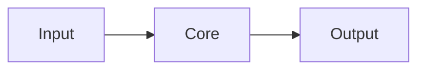

<div align="center">


<h1>PROJECT</h1>

<p><b>One sentence that says what it does and why someone should care.</b></p>

<p>
<a href="LINK"></a>
<a href="LINK"></a>
<a href="LICENSE"></a>

</p>

<p>
<a href="WEBSITE">Website</a> ·
<a href="DOCS">Docs</a> ·
<a href="#-quick-start">Quick start</a> ·
<a href="https://github.com/OWNER/REPO/releases">Download</a>
</p>


</div>

## ✨ Why PROJECT

- ⚡ **Benefit one.** One sentence about the outcome.
- 🔒 **Benefit two.** One sentence.
- 🧩 **Benefit three.** One sentence.

## 📸 Gallery

<table>
<tr>
<td width="50%"><p align="center"><sub><b>Feature A</b> — caption</sub></p></td>
<td width="50%"><p align="center"><sub><b>Feature B</b> — caption</sub></p></td>
</tr>
</table>

<!-- Video: paste a https://github.com/user-attachments/assets/... URL on its own line, or a YouTube thumbnail link -->

## 🚀 Quick start

```bash
git clone https://github.com/OWNER/REPO.git
cd REPO
INSTALL_COMMAND
RUN_COMMAND
```

<details>
<summary><b>Other install options</b></summary>

```bash
brew install REPO   # macOS
```

</details>

## 🛠️ Usage

```bash
EXAMPLE_COMMAND
```

| Option | Default | Description |
|:--|:--|:--|
| `--flag` | `value` | What it does |

## 🧠 How it works



## 🗺️ Roadmap

- [x] Shipped thing
- [ ] Next thing

## 🤝 Contributing

PRs welcome. See [CONTRIBUTING.md](CONTRIBUTING.md).

## 📄 License

[MIT](LICENSE) © AUTHOR

<div align="center">
<sub>If this helped you, consider giving it a ⭐ · <a href="#top">Back to top ↑</a></sub>
</div>
